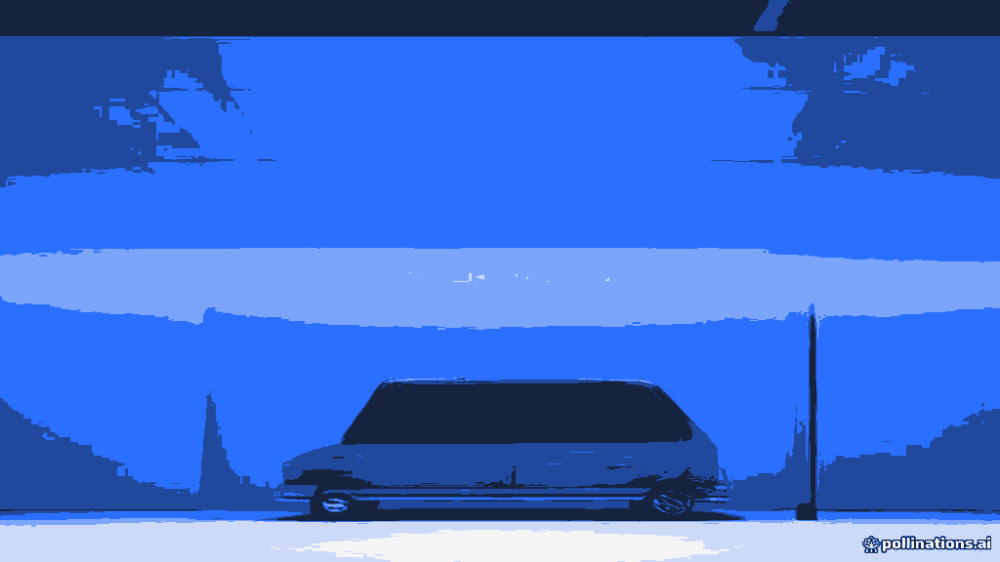
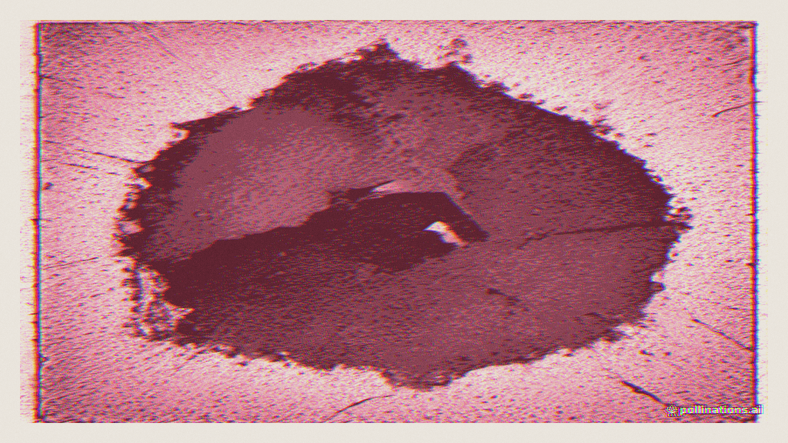
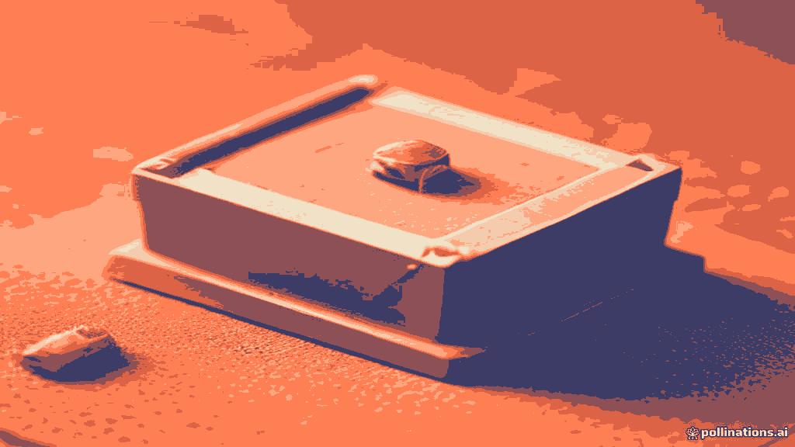

# Sample outputs

Produced by running `./scripts/run_samples.sh` against the live pipeline.
For each topic this is the most recent `completed` run, or the most
recent `partial` one if none completed. Records are copied verbatim -
nothing here is hand-edited.
Every folder holds the piece (`content.md`), the generated image
(`image.png`) and the complete run record (`run.json`: selection,
per-stage timings, token usage, cost, QC verdict).

Formats and art directions were **not** specified - the diversity engine
chose them, which is why no two rows share a combination.

| # | Topic | Format | Angle | Art direction | Palette | Words | Rev | Model | Image | Time |
|---|-------|--------|-------|---------------|---------|-------|-----|-------|-------|------|
| 1 | [How dealerships use AI to cut service-bay turnaround time](./how-dealerships-use-ai-to-cut-service-bay-turnar/content.md) | `opinion` | `risk` | `flat_vector` | `monochrome_pop` | 538 | 0 | `gemini-3.5-flash-lite` | `pollinations` | 35s |
| 2 | [EV battery recycling in India: who actually pays?](./ev-battery-recycling-in-india-who-actually-pays/content.md) | `article` | `beginner` | `collage` | `oxblood_stone` | 535 | 1 | `gemini-3.5-flash-lite` | `pollinations` | 48s |
| 3 | [The case against micro-SaaS](./the-case-against-micro-saas/content.md) | `trend_analysis` | `practitioner` | `cinematic_render` | `teal_copper` | 595 | 1 | `gemini-3.5-flash-lite` | `pollinations` | 45s |
| 4 | [What the ONDC rollout means for small retailers](./what-the-ondc-rollout-means-for-small-retailers/content.md) | `guide` | `comparison` | `isometric_3d` | `cobalt_sand` | 554 | 0 | `gemini-3.5-flash-lite` | `pollinations` | 47s |

**4 assets · average 44s end-to-end (budget 300s) · 30,078 tokens · $0.000 total.**

Status: 4 `completed`, 0 `partial`. A `partial` means a usable asset exists with a named caveat - the failing check is listed in that run's `run.json` under `qc`. It is reported rather than hidden; see docs/DESIGN.md §5.

### How to read these

* **Cost is $0.000 because the free tier is genuinely free**, not
  because accounting is missing. Token counts are recorded per call
  in each `run.json`; set `PRICE_INPUT_PER_MTOK` /
  `PRICE_OUTPUT_PER_MTOK` to price the same traffic on a paid tier.
* **The model column is observed, not configured.** Gemini enforces
  free-tier quota *per model*, so a run may be served by a different
  model than the one requested - the provider falls forward rather
  than failing. Seeing more than one model across these rows is the
  mechanism working.
* **Art direction is applied deterministically after generation**
  (`forge/providers/image/treatment.py`), because the free renderer
  ignores style instructions in the prompt. That is why the images
  differ visibly from each other rather than only in subject.

## Images

### AI Will Destroy Dealership Service Bays Before It Speeds Them Up

*flat_vector · monochrome_pop · generated by `pollinations`, treatment `flat_vector`*

### India's Lithium Battery Liability

*collage · oxblood_stone · generated by `pollinations`, treatment `collage`*

### The Death of Micro-SaaS

*cinematic_render · teal_copper · generated by `pollinations`, treatment `cinematic_render`*

### ONDC Breaks the Marketplace Monopoly: How to Integrate Small Retailers Without Amazon

*isometric_3d · cobalt_sand · generated by `pollinations`, treatment `isometric_3d`*

